# anvil

Toolkit de skills para Claude Code. Sucede o [mosk](https://github.com/rogerznts/mosk),
trocando agentes-como-persona por um conjunto curado de skills de terceiros.

**O anvil não escreve as próprias skills de trabalho.** Ele curadoriza 38 skills
de seis repositórios upstream, mantidos como submodules em `references/`, e as
vendoriza com adaptação registrada num manifesto — de forma que continuem
atualizáveis quando o upstream andar.

O toolkit é instalado **uma vez por usuário**, e vale para todos os projetos da
máquina. De qualquer diretório:

```bash
TMP="$(mktemp -d)" && npx degit rogerznts/anvil/anvil "$TMP"
bash "$TMP/.claude/skills/anvil-update/scripts/reset-install.sh" --dry-run --from "$TMP"
bash "$TMP/.claude/skills/anvil-update/scripts/reset-install.sh" --from "$TMP"
```

O primeiro comando baixa o payload para um diretório temporário; o segundo mostra,
por nome, o que entra em `~/.claude/`, `~/.agents/skills/` e `~/.omp/agent/` e o
que já estava lá e fica; o terceiro instala. Depois, em cada projeto:

```bash
claude
> /anvil-boot
```

O boot escreve no projeto só o que é dele: `.claude/rules/`, os perfis em
`docs/agents/` e a árvore de `docs/`, e **propõe** um `.gitattributes` na raiz
quando acha arquivo gerado pesando no diff da revisão. Sem instalação de usuário,
ele mesmo a faz, com o mesmo dry-run. Para trocar de versão, `/anvil-update`, de
qualquer diretório: um update atualiza todos os projetos da máquina de uma vez.

---

## A regra que governa tudo

> Tudo funciona no padrão das skills originais. A única coisa que o anvil impõe é
> **onde** o arquivo é salvo dentro de `docs/`. Bateu dúvida, o padrão é o da
> skill original.

Isso é possível porque as skills do Matt Pocock não têm caminho fixo: elas leem
`docs/agents/issue-tracker.md`, um documento do projeto. **A organização
documental do anvil é um perfil de tracker** — ao lado de github, gitlab e local
— e não um alvo de reescrita.

O resultado, medido em 2026-11-04 com
`bash .claude/skills/anvil-sync/scripts/vendor-sync.sh stats`:

| | |
|---|---|
| skills `vendored` no manifesto | 38 entradas, as 38 skills curadas. 37 têm árvore no upstream; `anvil-principles` é só `keep` e `extra` |
| linhas dos arquivos que existem no pin e no payload | 88.157 |
| **linhas nossas que diferem do upstream** | **215 — 0,24%** |
| arquivos deixados de fora (`strip`) | 63 |
| arquivos do anvil dentro de skill vendorizada (`keep`) | 5 arquivos · 458 linhas |
| material trazido de fora da árvore da skill (`extra`) | 24 arquivos · 435 linhas · 9 nossas |
| arquivo sem par, fora da conta | 0 |

*Linha nossa* é a que está no payload e não está na versão do pin. A definição
inteira, com o que conta à parte, está no próprio script.

Em dezessete dessas skills, os arquivos pareados têm **uma linha** de delta: o
`name:` do frontmatter. O que conta à parte fica fora dessa linha — o
`anvil-stack-payload` está entre as dezessete e carrega 2 arquivos `keep`.

---

## O fluxo, num projeto novo

```mermaid
flowchart TD
    A["instalação de usuário<br/>degit + reset-install.sh"] --> B["/anvil-boot"]

    subgraph boot ["Boot — uma vez por projeto"]
        direction TB
        B --> B1["garante a instalação<br/>de usuário"]
        B1 --> B2["varre o projeto<br/>propõe .gitattributes<br/>se achar gerado pesado"]
        B2 --> B3[".claude/rules/<br/>project.md · anvil.md<br/>comando com custo medido"]
        B3 --> B4["anvil-docs, sem verbo<br/>escolhe scaffold ou adopt<br/>architecture · discovery<br/>specs · agents"]
        B4 --> B5["anvil-setup<br/>docs/agents/issue-tracker.md"]
        B5 --> B6{"achou<br/>payload.config.ts?"}
        B6 -->|sim| B7["propõe rules/payload.md<br/>e espera aprovação"]
        B6 -->|não| B8
        B7 --> B8["confere a guarda de merge<br/>da instalação de usuário"]
    end

    B8 --> C["/anvil-grill"]

    subgraph janela ["Uma janela de contexto só — não compactar"]
        direction TB
        C -->|"glossary.md + ADRs"| D["/anvil-to-spec"]
        D -->|"new-spec.sh reserva 012 no origin<br/>docs/specs/012-feature-cupom/spec.md"| E["/anvil-to-tickets"]
        E -->|"issues/01…NN.md<br/>Blocked by · Status"| F["/clear"]
    end

    F --> G["/anvil-implement-spec<br/>um implementer novo por ticket<br/>no branch da spec"]
    G -->|"cada implementer chama"| H["/anvil-tdd"]
    H --> I["/anvil-code-review<br/>uma vez, sobre a spec inteira<br/>rodada 2 só sobre a correção"]
    I --> J{"todos os tickets<br/>Status: resolved?"}
    J -->|não| G
    J -->|sim| P["/anvil-docs archive<br/>promove ADR · move p/ archive/"]
    P --> K["/anvil-open-pr<br/>UM PR por spec"]
    K --> L{"hook: issues/ fechados<br/>e spec arquivada?"}
    L -->|"ticket aberto ou<br/>spec não arquivada"| M["bloqueia · exit 2"]
    L -->|sim| N["PR aberto<br/>corpo lista a spec e os tickets<br/>cada ticket ganha a URL de volta"]
    N --> O["merge<br/>a spec já chega arquivada"]

    style boot fill:#f8f8f6,stroke:#bbb
    style janela fill:#f8f8f6,stroke:#bbb
    style M fill:#fdecea,stroke:#c33
    style P fill:#eaf6ec,stroke:#3a3
    style O fill:#eaf6ec,stroke:#3a3
```



O `grill → to-spec → to-tickets` roda numa **janela só**, sem compactar. É o que
o fluxo do Matt exige, e é o que faz o encadeamento funcionar sem estado em
disco. Depois a `implement-spec` põe um implementer novo, que começa do zero, em
cada ticket, e **o ticket é o estado**: `Blocked by` carrega a ordem, `Status`
carrega o progresso. O ticket avulso, fora de uma spec, segue no `/anvil-implement`.

**O `archive` vem antes do PR, não depois do merge.** Promover o ADR e mover a
spec são mudança em arquivo, e depois do merge não sobra branch onde commitar —
seria um segundo PR só para mover pasta, com a spec parada no branch padrão sem
arquivar no intervalo. Antes do PR, o move entra no mesmo diff que vai ser
revisado, e a guarda de merge impõe a ordem.

**Nenhuma skill do fluxo sabe o que é `docs/specs/`.** Todas leem o perfil.

---

## Três harnesses, um condutor de spec

O anvil roda no Claude Code, no Codex e no omp. As skills são as mesmas nos três,
e nos três a `anvil-implement-spec` conduz a spec: um implementer novo por ticket,
cada um no próprio worktree, tudo junto no branch da spec e um review só no fim —
ver [adr-0023](docs/architecture/adr/adr-0023-implement-spec-conduz-a-spec-com-review-unico.md).
Só no omp o resto do fluxo é conduzido, o planejamento e o piloto automático,
porque ele tem `task`, agentes próprios e sessões filhas que nascem sem a conversa
do pai — ver
[adr-0011](docs/architecture/adr/adr-0011-omp-como-harness-com-camada-propria.md).

**Como a camada chega.** O reset da instalação de usuário procura o omp: o
binário no `PATH`, o diretório `~/.omp/` ou uma linha `omp:` no lock de usuário,
`~/.claude/anvil.lock`. Qualquer um basta, e a camada omp entra em `~/.omp/agent/`
sem pergunta à parte, com as diretivas do anvil como uma rule `alwaysApply`. A
linha `omp:` a mantém no update de uma máquina sem os outros dois sinais. Quem roda
o reset é o `/anvil-update`; o `/anvil-boot` só o roda na primeira instalação, sem
`~/.claude/anvil.lock`, e numa máquina que ganhou o omp depois do anvil a camada
chega no próximo `/anvil-update`. O mesmo reset mantém `~/.agents/skills`, por onde
o Codex e o omp leem as skills: um symlink para `~/.claude/skills/<nome>` por skill
do lock.

**O que o omp ganha.** Lá, skill se chama por `/skill:<nome>`, e o boot é
`/skill:anvil-boot`.

| | |
|---|---|
| `/skill:anvil-plan <pedido>` | conduz grill, to-spec e to-tickets na mesma janela. Entre uma etapa e outra propõe a próxima ou um desvio, como research ou prototype, e só carrega com o seu sim |
| `/skill:anvil-implement-spec` | conduz a spec, como nos outros harnesses. A rule da camada traduz o worktree de cada implementer no `task` com `isolated: true` e o merge na integração do omp no modo branch, e aí os tickets independentes rodam ao mesmo tempo; sem esse modo, um por vez |
| `/skill:anvil-omp` | o manual da camada: detecção, limites e como removê-la |
| guarda de merge | um hook em `~/.omp/agent/hooks/pre/` chama o mesmo `guard-spec-merge.sh` do Claude Code, da instalação de usuário |

**O que segue manual.** No Claude Code e no Codex, a lista de skills é a de sempre,
e dos comandos acima só a `/anvil-implement-spec` existe, porque vem do payload. O
fluxo é `/anvil-grill`, `/anvil-to-spec`, `/anvil-to-tickets` e a
`/anvil-implement-spec`, com os subagentes e os worktrees do próprio harness; o
`/anvil-implement` fica para o ticket avulso. O Claude Code tem a guarda pelo hook
do `~/.claude/settings.json`, e o Codex não tem guarda.

**A guarda vale para toda a máquina, mas só age em projeto anvil**, o que tem a
rule `.claude/rules/anvil.md` que o boot escreve. Num outro repositório, `git
merge` passa sem mensagem. Num projeto anvil, ela lê a spec do projeto e chama o
`validate.sh` da instalação de usuário.

---

## As skills

### Fluxo principal — da ideia ao merge

| skill | para quê | origem |
|---|---|---|
| `anvil-grill` | entrevista que afia o plano e **escreve enquanto decide**: glossário, ADRs, e o fluxo de usuário em `specs/{id}/ui/` | mattpocock |
| `anvil-to-spec` | transforma a conversa em spec, sem entrevistar de novo | mattpocock |
| `anvil-to-tickets` | corta a spec em tickets *tracer bullet*, cada um declarando o que o bloqueia | mattpocock |
| `anvil-implement` | constrói a partir do ticket; chama `tdd` e `code-review` por dentro | mattpocock |
| `anvil-code-review` | revisa o diff em dois eixos independentes — Standards e Spec | mattpocock |
| `anvil-implement-spec` | conduz a spec inteira num branch de integração, nos três harnesses: um implementer novo por ticket, em worktree próprio, e um review só no fim, com a rodada 2 só sobre a correção | mattpocock |
| `anvil-tdd` | ciclo vermelho-verde que produz teste que se mantém, em seams acordados | mattpocock |
| `anvil-browser-qa` | gera checklist de browser e conduz testes assistidos ou autônomos, com evidência visual | autoral |

### Entender antes de mudar

| skill | para quê | origem |
|---|---|---|
| `anvil-how` | *"como X funciona?"* — passeio pelo código, camadas, onde uma coisa deveria morar | pstack |
| `anvil-research` | investiga contra fonte primária e devolve um documento com citação por afirmação | mattpocock |
| `anvil-distill` | destila uma funcionalidade de um sistema de referência em `references/`: ponteiros `caminho:linha`, tradução para a stack do projeto e o que não portar | autoral |
| `anvil-diagnose` | bug difícil: constrói o loop de feedback antes de levantar hipótese | mattpocock |
| `anvil-domain-modeling` | constrói o glossário e os ADRs; a linguagem ubíqua do projeto | mattpocock |
| `anvil-codebase-design` | vocabulário de módulo profundo, seam, interface, alavanca | mattpocock |

### Decidir a forma

| skill | para quê | origem |
|---|---|---|
| `anvil-architect` | esboça tipos, assinaturas e módulos **antes** do código, e fica no loop | pstack |
| `anvil-arena` | N candidatos em paralelo, um juiz independente, enxerta o melhor de cada | pstack |
| `anvil-prototype` | protótipo descartável para responder uma pergunta de design que só se responde vendo rodar. A decisão volta para o documento; o protótipo morre fora da main | mattpocock |
| `anvil-wayfinder` | trabalho grande demais para uma sessão: mapa de tickets de decisão | mattpocock |
| `anvil-principles` | os 24 princípios que `poteto`, `architect` e `arena` citam | pstack |
| `anvil-poteto` | modo de trabalho: todolist, playbook por formato de tarefa, prosa sem gordura | pstack |
| `anvil-swarm` | espalha N workers em paralelo e devolve um relatório só: cobertura, corrida, exploração | pstack |
| `anvil-interrogate` | revisão adversarial: adversários tentam quebrar a mudança, e só sobrevive achado provado por execução | pstack |
| `anvil-benchmark-checklist` | confere uma medição de desempenho antes de reportar ou agir sobre ela | pstack |
| `anvil-in-your-own-words` | reformula, com as próprias palavras, o objetivo do usuário; o `interrogate` parte dela | pstack |

### Interface

O `anvil-ui` é **roteador**: escolhe um método e só um, porque `hallmark` e
`taste` são rivais — um entrega um tema como material, o outro parte de uma ideia
tirada do assunto e mede a página num navegador real. Quem parte de uma
referência passa antes pelo `anvil-ui-study`, que entrega ao hallmark.

| skill | para quê | origem |
|---|---|---|
| `anvil-ui` | decide qual método usar antes de qualquer código | autoral |
| `anvil-ui-hallmark` | página nova a partir de um tema sorteado de um catálogo de 50 e de uma forma entre 21 macroestruturas; escopo próprio de componente, com os oito estados; `redesign` e `audit` só quando nomeado | hallmark |
| `anvil-ui-taste` | página e tela de app, novas ou existentes: três de 20 direções contra um inventário do assunto, inspector em navegador real e crítica por screenshots. Pede Node 22+ e Chrome | taste |
| `anvil-ui-study` | extrai o DNA de design de uma URL ou screenshot de referência, recusa cópia e template pago, e grava um `design.md` que o hallmark lê como sistema travado | autoral |

### Escrita e comunicação

| skill | para quê | origem |
|---|---|---|
| `anvil-unslop` | corta os tiques de LLM de qualquer texto. Vale sempre | pstack |
| `anvil-writing-for-agents` | escrever documento que um agente vai ler: divulgação progressiva, ponteiro de contexto | mattpocock |
| `anvil-wait-what` | *"essa mensagem não chegou — reformule"* | mattpocock |
| `anvil-grill-me` | a entrevista sem diretório de trabalho | mattpocock |
| `anvil-grilling` | a primitiva de entrevista que `grill`, `grill-me` e `wayfinder` chamam | mattpocock |
| `anvil-to-questionnaire` | vira o que você não sabe responder num questionário para outra pessoa | mattpocock |
| `anvil-teach` | ensina um conceito, com aulas em HTML e registro de aprendizado | mattpocock |
| `anvil-handoff` | compacta a sessão num documento para outro agente continuar | mattpocock |
| `anvil-retro` | retrospectiva de uma sessão: sugere melhorias no ambiente do agente — navegação, checks, padrões, economia de ferramenta | mattpocock |
| `anvil-next` | escolhe a próxima rota e gera um prompt curto para continuar em outra sessão | autoral |

### Infraestrutura do toolkit

| skill | para quê | origem |
|---|---|---|
| `anvil-boot` | prepara o projeto: garante a instalação de usuário, rules, `docs/`, tracker, stack, hook | autoral |
| `anvil-update` | reinstala a instalação de usuário do zero, apagando órfãos pelo `anvil.lock` | autoral |
| `anvil-docs` | onde o documento mora, como a spec se chama, e o que acontece quando fecha | autoral |
| `anvil-setup` | escreve o perfil do issue tracker que o fluxo lê | mattpocock |
| `anvil-wizard` | gera um wizard em bash para o passo que só um humano pode fazer | mattpocock |
| `anvil-commit` | commit em Conventional Commits, sem pular hook | autoral |
| `anvil-open-pr` · `anvil-open-fast-pr` | PR no GitHub ou no Gitea, para o branch base, **um por spec**: o corpo segue a `anvil-pr` e lista a spec e seus tickets, e cada ticket ganha a URL do PR de volta | autoral |
| `anvil-pr` | o molde do corpo do PR: resumo visual, evidência antes e depois, e o risco do merge | mattpocock |
| `anvil-prune-branches` | atualiza o branch base e remove branch local cujo remoto sumiu | autoral |

### Segurança

| skill | para quê | origem |
|---|---|---|
| `anvil-security-audit` | auditoria de segurança por código-fonte em seis fases, com coverage ledger, validação adversarial e achados validados por schema. Sem pedido explícito de auditoria completa ou de relatório, só orienta, sem gravar arquivo | cloudflare |

A auditoria completa grava os artefatos fora do repositório auditado, por padrão
em `~/security-audit-skill/<repo>/run-<N>`, e dentro dele só num diretório que o
usuário escolha e que o git ignore. O motivo: um achado confirmado traz arquivo,
linha, entrada e resultado — é um exploit pronto —, e um commit não se desfaz:
apagar depois não o tira do histórico, dos clones nem do diff de um PR. O que
entra no repositório é só o registro da auditoria, pelo `/anvil-docs security`:
o que foi coberto e quantos achados houve, sem caminho nem reprodução. Os motivos
completos estão no
[ADR-0019](docs/architecture/adr/adr-0019-auditoria-de-seguranca-vendorizada-da-cloudflare.md).

### Stack

| skill | para quê | origem |
|---|---|---|
| `anvil-stack-payload` | o ofício do Payload em 11 arquivos, mais a `RULE.md` com as quatro ciladas | payloadcms |

---

## Organização documental

O que o anvil impõe é **só a pasta**. O conteúdo dentro dela é integralmente das
skills originais.

```
docs/
├── index.md                       auto-gerado
├── agents/issue-tracker.md     ●  o perfil que o fluxo lê
├── architecture/               ●  glossary.md · adr/
├── discovery/                  ●  anvil-research
├── specs/                      ●
│   ├── 012-feature-checkout-coupon/     ← só a PASTA é do anvil
│   │   ├── spec.md                        anvil-to-spec, com as User Stories
│   │   ├── issues/01-modelo-de-cupom.md   anvil-to-tickets
│   │   │     **Blocked by:** —
│   │   │     **Status:** resolved
│   │   ├── ui/                            fluxo e comportamento desta mudança
│   │   ├── qa/                            checklist e evidências de browser
│   │   └── map.md                         anvil-wayfinder, quando usado
│   └── archive/
│
├── qa/                         ◆  anvil-browser-qa
└── prd/  ui/  project/         ○  reconhecidos, nascem quando houver conteúdo
```

**●** o `scaffold` cria · **◆** a skill cria no primeiro uso · **○** nasce só
quando você escrever

**Não há skill que autore PRD.** A spec é a unidade e carrega suas próprias User
Stories — o `to-spec` pede uma lista *"extremely extensive"*. Camada de épico
atravessando specs, se você quiser, é escrita à mão em `prd/`.

O **branch** é `{tipo}/{NNN}-{nome}` — string diferente da pasta, de propósito.
Resolva sempre pelo prefixo numérico, nunca por igualdade.

Não há `spec-meta.yaml`, `tasks.md` nem `gate.yaml` no fluxo normal. **O estado é
lido do disco:** `spec.md` existe → especificado; `issues/` com `Status` diferente
de `resolved` → em andamento; pasta sob `archive/` → arquivado.

---

## O que fica onde

**O toolkit não mora no projeto.** Ele é instalado uma vez por usuário, e o clone
de um projeto não o traz: quem clona instala o anvil na própria máquina, como diz
a rule `.claude/rules/anvil.md` que o boot escreve.

| | |
|---|---|
| `~/.claude/skills/` | as skills instaladas |
| `~/.claude/agents/` | os agentes instalados, se o payload trouxer algum |
| `~/.claude/anvil.lock` | o que a instalação de usuário possui, e o que o update usa para calcular órfãos |
| `~/.claude/CLAUDE.md` | o bloco `ANVIL:DIRECTIVES`, que o Claude Code carrega em toda sessão; o resto do arquivo é seu |
| `~/.claude/settings.json` | o hook da guarda de merge, uma entrada em `hooks.PreToolUse`; o resto do arquivo é seu |
| `~/.agents/skills/` | o espelho: um symlink por skill, lido pelo Codex e pelo omp |
| `~/.omp/agent/` | a camada omp, com as diretivas como rule `alwaysApply` |
| `.claude/rules/` | do projeto: o contexto que o boot levantou dele |
| `.claude/settings.json` | do projeto, se ele tiver: a guarda de merge não mora mais nele |
| `docs/` | do projeto: o trabalho |

Um projeto bootado antes ignorava o toolkit no `.gitignore`, por um bloco
`ANVIL:INSTALLED` ou por uma linha que cobria `.claude/skills/` inteiro. O boot
acha os dois, mostra o antes e o depois, e **propõe removê-los**. Linha parecida
que o boot não escreveu não é tocada.

Um projeto instalado do jeito antigo, com cópia do toolkit nele, é migrado pelo
`/anvil-update` ou pelo `/anvil-boot` rodado nele, um projeto por vez. Guiada pelo
`.claude/anvil.lock` do projeto, a migração tira as skills, os agentes, o lock, os
symlinks de `.agents/skills`, os arquivos de `.omp/` do lock, a guarda copiada com
o hook dela no `.claude/settings.json` e o bloco `ANVIL:DIRECTIVES` do `CLAUDE.md`.
O que é do projeto fica. Sem lock, ela pergunta antes quais skills e agentes não
vieram do anvil. Exige árvore limpa, mostra um dry-run, espera aprovação e nunca
commita. O que sai fica em duas partes: o que o git conhece aparece no
`git status` para você revisar; o que está fora do git — o toolkit ignorado por um
`.gitignore` antigo, pelo `.git/info/exclude` ou pelo excludes global, e o arquivo
ignorado dentro de item versionado, como um `.DS_Store` — sai junto e aparece,
arquivo por arquivo, no grupo "sai junto, fora do git, sem volta pelo git" do
dry-run.

---

## Vindo do mosk

O boot detecta e **propõe** a migração, esperando aprovação antes de apagar.

| Sai | Fica |
|---|---|
| `.claude/agents/mosk-*.md` — as doze personas | `.claude/rules/` — é do projeto |
| `.claude/mosk/` — 252 arquivos de core | `docs/` — vai para o verbo `adopt` |
| `.claude/skills/mosk-*` | `.claude/settings.json` — sai só a entrada do hook do mosk |

No `CLAUDE.md`, o bloco `MOSK:DIRECTIVES` sai, e nada entra no lugar: as
diretivas do anvil vêm da instalação de usuário. Ele não pode ficar, porque as
regras de idioma se contradizem — o mosk mandava escrever artefato em inglês, o
anvil manda em pt-BR.

As specs em layout antigo — `spec-meta.yaml`, `tasks.md`, `stories/` — são
convertidas pelo verbo `adopt`, que classifica **lendo o arquivo, nunca o nome**,
e mostra o plano inteiro antes de mover qualquer coisa.

---

## Manutenção da curadoria

Não vai no degit. Vive no repositório do anvil.

```bash
S=.claude/skills/anvil-sync/scripts/vendor-sync.sh

bash $S status          # o que andou upstream desde cada pin
bash $S pull            # atualiza os submodules
bash $S vendor <nome>   # primeira cópia de uma skill
bash $S update [<nome>] # merge 3-way; sem argumento, todas
bash $S verify          # integridade do payload
bash $S stats           # a métrica do topo deste README
```

**O pin do submodule é a base do merge.** Nenhum snapshot é guardado:

```
base   = git -C <submodule> show <pin>:<path>/<arquivo>
theirs = git -C <submodule> show <HEAD>:<path>/<arquivo>
ours   = anvil/.claude/skills/<nome>/<arquivo>
```

O catálogo de adaptações é **fechado**: `rename`, `invocable`, `docs-remap`,
`decursor`, `tracker-profile`, `verification-profile`, `ask-rounds`,
`keep`/`strip`/`extra`. Se uma mudança não cabe em nenhuma, ela não deveria estar
sendo feita. E há uma lista do que **nunca** é adaptação: traduzir, enxugar,
uniformizar vocabulário entre skills, corrigir erro do upstream.

### Desenvolver sem afetar os outros projetos

A instalação publicada continua no diretório do usuário. Para trabalhar na fonte
do anvil, abra uma sessão pelo launcher na raiz deste repositório:

```bash
bash .claude/skills/anvil-sync/scripts/dev-run.sh --dry-run -- omp
bash .claude/skills/anvil-sync/scripts/dev-run.sh -- omp
# Também aceita: -- claude ou -- codex
```

O launcher prepara links em `workspace/anvil-dev/home/` e troca o HOME só do
processo e seus filhos. Skills e scripts `~/...` chegam à mesma fonte; abrir
`omp`, `claude` ou `codex` normalmente continua usando a instalação publicada.
Configuração, sessões e login dev ficam separados. Não há cópia de credenciais
ou importação automática de terceiros. Ferramentas que consultam HOME precisam
de configuração dev ou variáveis explícitas. Não é sandbox nem separação dos
serviços de credenciais do SO; veja os limites no
[ADR-0018 — HOME dev por checkout](docs/architecture/adr/adr-0018-dev-home-isolado-por-checkout.md).

No primeiro uso, autentique o cliente pelo mesmo launcher, por exemplo
`dev-run.sh -- omp login`, `dev-run.sh -- claude auth login --claudeai` ou
`dev-run.sh -- codex login` (usando o caminho completo do launcher acima).
Sem login ou chave de ambiente, o omp pode recusar a abertura por não ter modelo
padrão. Não execute o login Console do Claude como se fosse isolado: o serviço
de credenciais do SO pode afetar a conta pessoal.

Para quem usava a ligação dev global antiga, o cutover é explícito, fora do
launcher: `bash .claude/skills/anvil-sync/scripts/dev-link.sh --unlink --dry-run`,
depois `--unlink`, e instalação publicada com os comandos do início deste README,
revisando o dry-run antes da execução. O launcher não altera a instalação pessoal
nem faz esse cutover automaticamente.

---

## Estrutura do repositório

```
anvil-skills.yaml             manifesto de curadoria      ─┐ não vão
.claude/skills/anvil-sync/    ferramenta de manutenção    ─┘ no degit
references/                   submodules — os pins são a base do merge
  skills/      mattpocock/skills
  plugins/     cursor/plugins (pstack)
  hallmark/    Nutlope/hallmark
  taste/       Leonxlnx/taste-skill
  payload-skills/  payloadcms/skills
  security-audit-skill/  cloudflare/security-audit-skill
  mosk/        rogerznts/mosk (herança)
anvil/                        o payload que a instalação de usuário copia
docs/                         a documentação do próprio anvil
```

As decisões de arquitetura estão em [`docs/architecture/adr/`](docs/architecture/adr/)
e o plano de construção em [`docs/project/plan.md`](docs/project/plan.md).

## Crédito

O trabalho está nos repositórios upstream. O anvil é curadoria.

[mattpocock/skills](https://github.com/mattpocock/skills) ·
[cursor/plugins](https://github.com/cursor/plugins) ·
[Nutlope/hallmark](https://github.com/Nutlope/hallmark) ·
[Leonxlnx/taste-skill](https://github.com/Leonxlnx/taste-skill) ·
[payloadcms/skills](https://github.com/payloadcms/skills) ·
[cloudflare/security-audit-skill](https://github.com/cloudflare/security-audit-skill)
