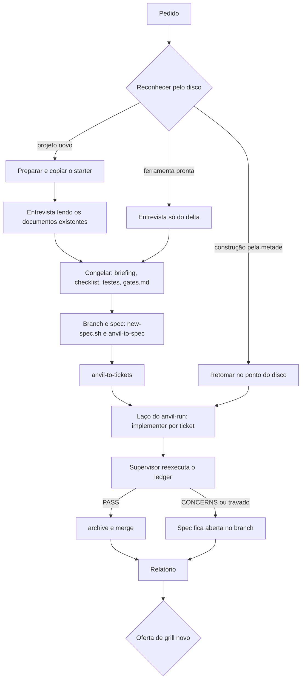

# Bench autônomo: da entrevista ao app entregue

Proposta para pôr o `anvil-bench` sobre o `anvil-plan` e o `anvil-run` e torná-lo
autônomo depois da entrevista. Ele abre o branch, escreve spec e tickets,
implementa, verifica e fecha. Termina com um relatório do que foi feito, das
decisões que tomou sozinho e das que ainda dependem de alguém, e oferece um grill
novo a partir disso.

Escrita antes do grill. Aqui ficam o pedido, o estado de hoje, o que esbarra em
decisão já aceita e as perguntas que o grill precisa fechar.

## O pedido

> Ele vai criar branchs, specs, tudo com base numa boa entrevista e documentos
> existentes ou criados, ele consegue fazer um app de ponta a ponta e dá pass se
> precisar, entregando um relatório completo do que foi feito no final, decisões
> que tomou e se espera por mais decisões, e com base nisso dá opção de um novo
> grill.

Leitura adotada, para o grill confirmar:

- **Humano só na entrada e na saída.** A entrevista é com a pessoa. Do
  congelamento do combinado até o relatório, nenhuma pausa espera resposta.
- **"Documentos existentes ou criados".** Antes de perguntar, a entrevista lê o
  que o projeto já tem: `docs/discovery/`, `docs/prd/`, briefings anteriores e o
  código. O que não existe ela cria, como o `briefing.md` e o `checklist.yaml` que
  o bench já grava.
- **"Dá pass se precisar".** Há duas leituras, e o grill escolhe:
  1. o bench responde **sim** às pausas que o `anvil-plan` hoje devolve ao
     operador, e com isso ele se autoaprova;
  2. o bench fecha a spec quando o gate dá **`PASS`**, e só nesse caso.

  As duas não se excluem. A proposta abaixo assume as duas: a autoaprovação
  move o fluxo, e o `PASS` reexecutado é o que libera o fechamento.

## Onde está hoje

O bench já roda sem parar, mas só na fase de construção (`SKILL.md`, fase 5). O
resto se divide assim:

| Fase do bench | Autônoma hoje? | O que falta para o pedido |
|---|---|---|
| 1. Preparar | sim | — |
| 2. Reconhecer | sim, para projeto novo e para "evoluir" | ramo de **retomada**: construção interrompida no meio |
| 3. Entender | não, é a entrevista | ler os documentos existentes antes de perguntar |
| 4. Congelar e testar | sim | — |
| 5. Construir | sim, com loop próprio | usar o `anvil-run` no lugar do loop próprio; abrir o branch |
| 6. Entregar | sim | fechar a spec (archive, merge), relatório completo, oferta de grill |

O bench não fala de branch, merge nem archive em lugar nenhum (`SKILL.md`,
`GATE.md`, `CHECKLIST.md`). Hoje, se o bench rodasse, as specs ficariam abertas.

## O que o plan e o run fazem, e onde param

| Peça | Faz | Para em |
|---|---|---|
| `anvil-plan` | conduz `grill → to-spec → to-tickets` numa janela, com o estado lido do disco pelo `stage.sh` | **cada etapa**: só carrega a próxima com o sim do operador; nunca troca de branch nem roda o `anvil-run` |
| `anvil-run` | deriva o frontier do disco pelo `frontier.sh` e despacha um `anvil-implementer` por ticket, em série ou em leva com isolação | `all_resolved`, `halt` (árvore suja) ou ticket travado em `round=2 verdict=fail`; nunca faz archive, browser QA, PR, merge nem cria branch |

As duas peças já leem o estado do disco, e é por isso que dá para retomar: a
autonomia não precisa de máquina de fases (ADR-0003). O que segura as duas são as
pausas e as proibições, e cada uma delas foi decidida em ADR.

## O que esbarra em decisão aceita

Cada linha abaixo é uma regra que a autonomia quebra. O grill decide, linha a
linha, entre abrir exceção para o bench e manter a regra.

| Decisão | O que diz | Onde o pedido esbarra |
|---|---|---|
| ADR-0011, planejamento | o `anvil-plan` só carrega etapa com o sim do operador | o bench responderia sim sozinho |
| ADR-0011, implementação | a execução para em "todos resolvidos"; browser QA, archive e PR ficam com o usuário | o bench fecharia a spec |
| ADR-0011, harness | a automação só existe no omp; Claude Code e Codex seguem manuais | o bench é skill do núcleo e hoje roda no Claude Code |
| ADR-0010, orçamento | duas rodadas por artefato; a terceira é escolha declarada de um humano | o bench tem teto de **três** tentativas por ticket (`GATE.md`). Isso já diverge hoje, antes desta proposta |
| Perfil do tracker | fechar = `/anvil-docs archive` → `/tea-open-pr` → merge, e a guarda bloqueia merge sem spec arquivada | o merge sem pessoa nenhuma na conversa |
| Bench, INV-6 | quem pediu não vê jargão, log nem comando | o relatório precisa citar decisões técnicas para ser auditável |
| Bench, fase 3 | a entrevista usa o `anvil-grilling`, com perguntas restritas a módulos, papéis, regras, integrações, nomes e critério de pronto | o `anvil-plan` começa pelo `anvil-grill`, que pergunta como para quem programa |

Duas dessas linhas não são de autorização.

- **ADR-0010 contra o teto de três.** A regra do anvil é que a terceira rodada é
  um humano quem abre. Num fluxo sem humano, ela nunca se abre: o ticket travado
  vai para o relatório como pendência. A proposta adota as duas rodadas e corrige
  o `GATE.md`.
- **O `anvil-grill` contra o `anvil-grilling`.** Quem conversa com o bench não
  programa. A entrevista continua sendo a do bench, e o `anvil-plan` entra só
  depois dela, a partir de `anvil-to-spec`.

## O fluxo proposto

A pessoa participa só em três pontos: a entrevista, o relatório e a resposta à
oferta de grill.

### Retomada

O bench passa a ter um terceiro ramo na fase 2, decidido pelo disco:

| Sinal no disco | Ramo |
|---|---|
| sem starter nem rule da stack | projeto novo |
| starter e rule presentes, nenhuma spec aberta | evoluir |
| spec sem `issues/`, ou tickets sem `Status: resolved` | **retomar**: `stage.sh` diz a etapa do planejamento; `frontier.sh` diz o que falta construir |
| todos os tickets `resolved` e a spec fora de `archive/` | **retomar no gate**: reexecutar o ledger e fechar |

Retomar não repete a entrevista. O combinado está no `briefing.md`, no
`checklist.yaml` e no `decisions-log.md`, e o relatório diz em que ponto a
retomada entrou.

### Fechamento

- **Só `PASS` fecha.** O `PASS` vem do `gate-check.mjs --reverify` rodado pelo
  supervisor, nunca da marca no ledger (`GATE.md`). Com `PASS`: `/anvil-docs
  archive` no branch, depois o merge. A guarda continua valendo, e o bench não a
  contorna.
- **Com `CONCERNS`, ticket travado ou gate manual em aberto**, a spec fica aberta
  no branch, e o relatório diz o que segura o fechamento.
- **PR ou merge local** segue o perfil do tracker do projeto. Projeto sem remoto
  faz merge local. Projeto com remoto abre PR pelo `tea-open-pr`, e o merge do PR
  é decisão a fechar no grill (pergunta 3).

### O relatório final

Dois públicos e o mesmo conteúdo, em dois arquivos:

- **Para quem pediu**, no chat, em português simples (INV-6): o endereço, as
  credenciais, o que a ferramenta faz, o que ficou de fora e por quê.
- **Para auditoria**, em `docs/specs/{id}/report.md`: o que foi feito, ticket a
  ticket, com `Status` e `Review`; a série do `gate.yaml`; as decisões que o bench
  tomou sozinho, tiradas do `decisions-log.md` e separadas entre o que foi
  convenção e o que foi escolha; as lacunas registradas no `chega` da entrevista;
  as pendências (travados, gates manuais, `CONCERNS`).

As duas partes terminam na mesma seção, **"o que ainda espera decisão"**. Cada
item vem com a pergunta já formulada, e a oferta de grill novo usa essa lista
como pauta: o grill cobre só o delta, como a fase *Evoluir* já manda.

## Onde encaixa: três formas

| Forma | Como | A favor | Contra |
|---|---|---|---|
| **A. O bench conduz** | o bench chama as skills que hoje o `anvil-plan` e o `anvil-run` conduzem, com regras próprias de autoaprovação | uma porta só para quem não programa | duplica a condução; o bench passa a depender do omp, contra o ADR-0011 |
| **B. Condutor novo na camada omp** | uma skill `.omp/skills/anvil-bench-run` (nome a decidir) reusa o `stage.sh` e o `frontier.sh` e fecha a spec; o bench do núcleo chama esse condutor na fase 5 quando o omp está presente | não mexe no `anvil-plan` nem no `anvil-run`; respeita a regra de que a automação mora no omp | no Claude Code o bench continua parando no fim da construção |
| **C. Modo `--auto` no plan e no run** | as duas skills ganham uma flag que suspende as pausas e libera o fechamento | reusa tudo | põe a exceção dentro das peças que existem justamente para ter pausa; cada regra "nunca" ganha um "a não ser que" |

## Recomendação: condutor novo na camada omp

A forma B: um condutor novo na camada omp, que reaproveita o `stage.sh` e o
`frontier.sh`, em vez de um modo `--auto` no `anvil-plan` e no `anvil-run`.

**Por que não o `--auto`.** O `anvil-plan` e o `anvil-run` existem para ter pausa.
As regras "nunca" deles são o contrato que o ADR-0011 aceitou: carregar etapa só
com o sim, nunca trocar de branch, nunca fazer archive, PR ou merge. Uma flag que
suspende essas regras põe um "a não ser que" em cada uma, e quem lê a skill passa
a ter dois fluxos misturados no mesmo arquivo. Também cresce o risco de o modo
autônomo vazar para uma execução manual por uma flag esquecida.

**Por que não o bench conduzindo sozinho.** O bench é skill do núcleo e roda no
Claude Code. Pôr nele a condução de spec, tickets e implementer o amarra ao `task`
e aos agentes do omp, e copia a lógica que o `anvil-plan` e o `anvil-run` já têm.

**O que o condutor reaproveita e o que acrescenta.**

| Reaproveita, sem mudar | Acrescenta, só no condutor |
|---|---|
| `stage.sh`, para saber em que etapa do planejamento a spec está | responde sim às pausas entre `anvil-to-spec` e `anvil-to-tickets` |
| `frontier.sh` e o laço de despacho do `anvil-run`, com `anvil-implementer` por ticket | cria o branch pelo `new-spec.sh`, quando não há spec aberta |
| `anvil-to-spec`, `anvil-to-tickets`, `anvil-implement` e `anvil-code-review`, como estão | reexecuta o ledger com `gate-check.mjs --reverify` e grava o `gate.yaml` |
| a guarda de merge, sem contorno | com `PASS`: `/anvil-docs archive` e merge, ou PR, conforme o perfil do tracker |
| | escreve o `report.md` e oferece o grill novo |

As skills de etapa e os dois scripts continuam sendo a fonte. O condutor só
decide a ordem e responde às pausas. Um defeito corrigido no `frontier.sh`
corrige os dois fluxos.

**Como o bench o encontra.** Na fase 5, o bench do núcleo verifica se a camada
omp está presente. Com ela, entrega a construção e o fechamento ao condutor. Sem
ela, segue como hoje e para no fim da construção. O que acontece no Claude Code
fica para a pergunta 4.

**O que fica registrado.** Um ADR novo registra a exceção ao ADR-0011: "o bench
fecha a spec sem humano quando o ledger reexecutado dá `PASS`". O nome da skill
(`anvil-bench-run` é provisório) também é decidido no grill.

## Perguntas para o grill

1. "Dá pass" significa autoaprovar as pausas, fechar com `PASS`, ou as duas?
2. O modo autônomo vale só para o bench, com a stack plugada e o usuário que não
   programa, ou para qualquer projeto do anvil?
3. Com remoto, o bench abre o PR e para, ou abre e faz o merge?
4. A recomendação é o condutor novo na camada omp (B). Confirma? E, quando o bench
   rodar no Claude Code sem omp, ele para no fim da construção, como hoje, ou
   recusa o modo autônomo?
5. Gate manual (item do checklist sem `check`) segura o fechamento ou entra no
   relatório como pendência e deixa fechar?
6. O teto do bench passa de três tentativas para as duas rodadas do ADR-0010?
7. A entrevista lê documentos de fora do projeto, como um PDF ou uma planilha que
   a pessoa anexa, ou só o que está em `docs/`?
8. Retomar uma construção que começou fora do bench, sem `checklist.yaml` nem
   `gates.md`: o bench recusa, ou refaz as fases 3 e 4 sobre o que já existe?
